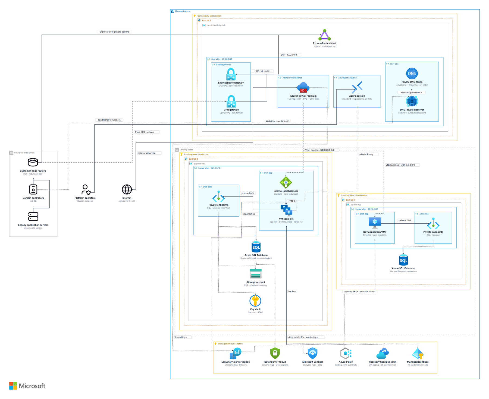
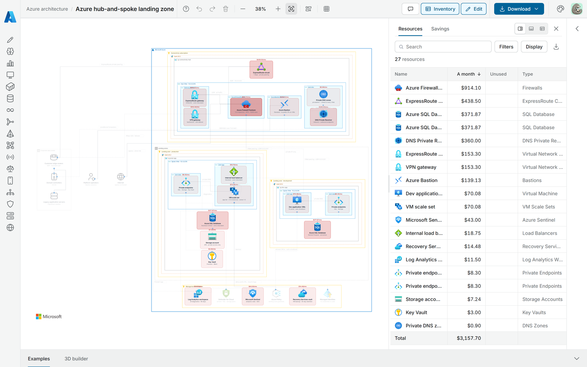
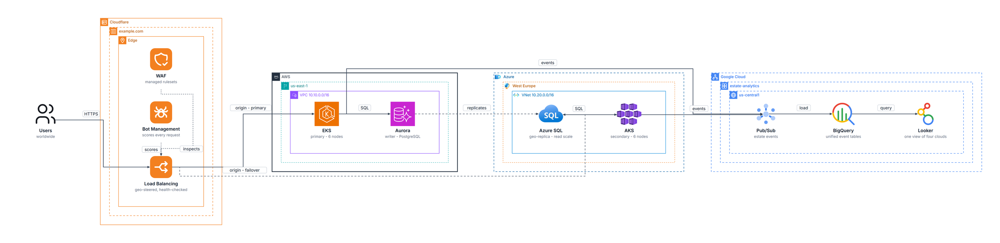

# Jose Lorenzo

Cloud platform engineer. I build and run the infrastructure, CI/CD and developer tools that engineering teams ship on, across AWS, Azure and Google Cloud. I'm now taking that into systems software in Rust and C++.

**Open to** platform, infrastructure and systems engineering roles, including trading and research infrastructure. · [LinkedIn](https://linkedin.com/in/joselrnz) · [Coulohm](https://coulohm.com)

**Languages:** Python, TypeScript, Bash, HCL, Rust, C++

**Platforms:** Linux, AWS, Azure, Google Cloud, Kubernetes, Docker, Terraform, PostgreSQL, GitHub Actions

## Building toward

- **Systems programming:** Rust and C++ on Linux, close to the operating system.
- **Embedded systems:** firmware and the boards it runs on.
- **Hardware:** PCB design, photonics and semiconductors.
- **Quantitative finance:** research platforms, market data and low-latency systems.

## Coulohm

<a href="https://coulohm.com">
  <picture>
    <source media="(prefers-color-scheme: dark)" srcset="assets/coulohm-dark.svg">
    
  </picture>
</a>

[Coulohm](https://coulohm.com) is my own work in circuits, electronics and computers.

## Selected work

| Project | What it does |
| --- | --- |
| [infragram](https://github.com/joselrnz/infragram) | Infrastructure diagrams as code for AWS, Azure, Google Cloud, Kubernetes and on-premises networks. Imports Terraform configuration, plans and state; reads live accounts read-only; prices a design; flags security problems; exports Terraform back out. 19 provider libraries, 3,600+ vendor icons and over 6,000 automated tests. Runs offline as a single HTML file, as an MCP server, or as a plugin for Claude Code, Codex, Cursor and GitHub Copilot. |
| [infragram-azure](https://github.com/joselrnz/infragram-azure) | The Azure edition: Azure, Kubernetes and Databricks, inventory across many subscriptions at once, Azure pricing, policy checks and Terraform. |
| [CodeGlance](https://github.com/joselrnz/CodeGlance) | Turns a repository into a visual map, a readable wiki and compact context files for coding agents. Runs locally, with no hosted service. |
| [pykantui](https://github.com/joselrnz/pykantui) | A local-first terminal kanban board. Work items from Jira, Linear, GitHub and seven other trackers become Markdown files you edit and sync back. |

*Infragram drawing a three-tier web app on AWS.*

### Hybrid network over ExpressRoute

*An Azure hub-and-spoke landing zone. The data centre reaches Azure over ExpressRoute private peering, with a site-to-site VPN as failover, and every flow passes through the hub firewall.*

### What it costs

*The same design priced from Azure's public list prices: about $3,158 a month, with the firewall alone at $914. The costliest parts are shaded on the map, so you can see where to cut before anything is built.*

### Four clouds, active-active

*Cloudflare steers traffic between a primary region on AWS and a secondary on Azure, with the database replicated between them, and Google Cloud runs the analytics for both.*

## Infrastructure repositories

- [core-infrastructure](https://github.com/joselrnz/core-infrastructure): Terraform configuration and deployment workflows.
- [terraform-cloud-modules-iac](https://github.com/joselrnz/terraform-cloud-modules-iac): reusable Terraform modules, including Azure networking and storage.
- [kubernetes-bootstrap](https://github.com/joselrnz/kubernetes-bootstrap): Kubernetes cluster bootstrap.
- [k8s-cluster-setup](https://github.com/joselrnz/k8s-cluster-setup): cluster setup scripts.
- [rss-feed-etl](https://github.com/joselrnz/rss-feed-etl): a data pipeline that extracts, filters and processes RSS feeds.
- [pyherdr](https://github.com/joselrnz/pyherdr): a Python port of herdr, a terminal multiplexer for AI coding agents.
- [agent-kit-board](https://github.com/joselrnz/agent-kit-board): a reference board for AI agent tools and workflows.

Find me on [LinkedIn](https://linkedin.com/in/joselrnz).
