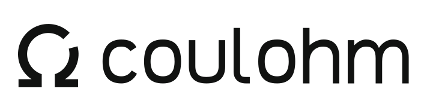

# Hi, I'm Jose

I'm a Cloud Platform Engineer moving into systems programming and embedded systems. I write Rust, C++, and Python on Linux, and I've spent my career building the infrastructure and developer tools other engineers run on.

Computer systems are being redesigned around accelerators, chiplets, and optical interconnects, and the software has to be written closer to the hardware than it used to be. That layer, where code meets silicon, is where I want to work.

[LinkedIn](https://linkedin.com/in/joselrnz) · [Coulohm](https://coulohm.com)

## Focus

- **Systems programming:** Rust and C++ on Linux, close to the operating system and the hardware.
- **Embedded systems:** firmware and the boards it runs on.
- **Quantitative finance:** research infrastructure, data platforms, and low-latency systems at asset managers and hedge funds.
- **Hardware:** PCB design, photonics, and semiconductors.

## Coulohm

<a href="https://coulohm.com">
  <picture>
    <source media="(prefers-color-scheme: dark)" srcset="assets/coulohm-dark.svg">
    
  </picture>
</a>

[Coulohm](https://coulohm.com) is where I build my own work in circuits, electronics, and computers.

## Selected work

| Project | What it does |
| --- | --- |
| [infragram](https://github.com/joselrnz/infragram) | Infrastructure diagrams as code for AWS, Azure, Google Cloud, Kubernetes and on-premises: an editor that works offline in one HTML file, Terraform import and export, read-only discovery of live accounts, cost estimates and policy checks. Runs as a plugin for Claude Code, Codex, Cursor and GitHub Copilot, or as an MCP server. |
| [infragram-azure](https://github.com/joselrnz/infragram-azure) | The Azure edition: Azure, Kubernetes and Databricks diagrams, read-only import across Azure subscriptions, prices, policy checks and Terraform. |
| [CodeGlance](https://github.com/joselrnz/CodeGlance) | Turns a repository into a visual map, a readable wiki, and compact context files for coding agents, generated locally with no hosted service. |
| [pykantui](https://github.com/joselrnz/pykantui) | A local-first terminal kanban board: work items from Jira, Linear, GitHub and seven other trackers become Markdown files you edit and sync back. |

*Infragram drawing a three-tier web app on AWS.*

## More projects

- [pyherdr](https://github.com/joselrnz/pyherdr): A Python port of herdr, a terminal multiplexer for AI coding agents.
- [core-infrastructure](https://github.com/joselrnz/core-infrastructure): Terraform infrastructure configuration and deployment workflows.
- [terraform-cloud-modules-iac](https://github.com/joselrnz/terraform-cloud-modules-iac): Reusable Terraform modules, including Azure networking and storage.
- [rss-feed-etl](https://github.com/joselrnz/rss-feed-etl): RSS extraction, filtering, and data-processing workflows.
- [kubernetes-bootstrap](https://github.com/joselrnz/kubernetes-bootstrap): Kubernetes setup and bootstrap work.
- [k8s-cluster-setup](https://github.com/joselrnz/k8s-cluster-setup): Cluster setup scripts.
- [agent-kit-board](https://github.com/joselrnz/agent-kit-board): A reference board for AI agent tools and workflows.

Find me on [LinkedIn](https://linkedin.com/in/joselrnz). This profile's source is in [joselrnz](https://github.com/joselrnz/joselrnz).
